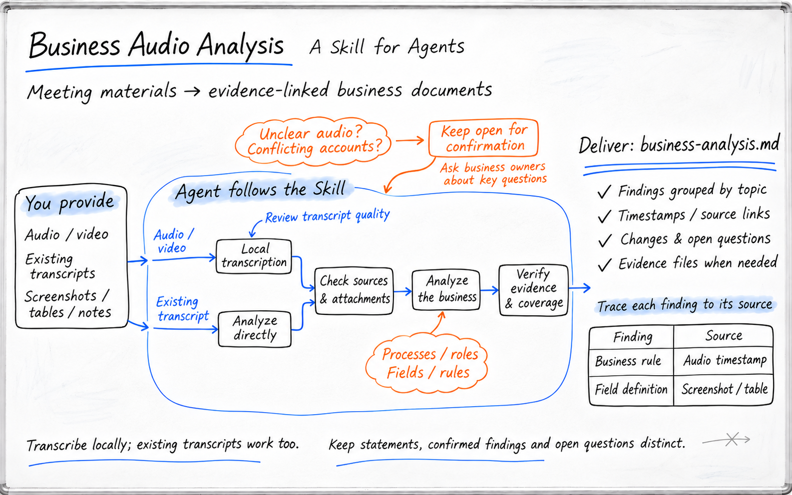

# Business Audio Analysis

[简体中文](README.md) · **English**

**Business audio analysis | Free local transcription**

Have your Agent review business recordings from a product manager's perspective, organizing processes, responsibilities, field rules, and open questions.

The Skill and local transcription are free, with no per-minute transcription fees. Agent subscriptions and model calls are billed separately.



*AI-generated illustration of the Skill workflow, not a product interface or a screenshot from a test run.*

[Quick overview](#quick-overview) · [Example](#purchase-approval-example) · [Quick start](#quick-start) · [Cost and privacy](#cost-and-privacy) · [View the Skill](https://github.com/nicoleyang959/business-audio-analysis/tree/main/skills/business-audio-minutes)

## Quick overview

Give your Agent recordings of business interviews, requirements conversations, or process discussions. Include relevant screenshots and spreadsheets if you have them.

The recording is transcribed on your computer, then the Agent organizes the material by business topic in Chinese Markdown. Use it to check existing processes, clarify requirements, or prepare material for a PRD. The raw transcript and quality report are retained so you can check important details against the recording.

## Purchase approval example

The interview, request form, and analysis below are fictional examples created for this README. They do not come from a real company or recording, and no speech recognition test was performed. The amounts and approval rules only illustrate the analysis approach.

This example has been translated into English for the README. The Skill produces Chinese documents by default.

### Input: simulated interview

Each passage has an evidence ID so you can check the reasoning in the analysis that follows.

```text
[S1 | Requester]
A purchase request can contain multiple line items. For each item, we enter
the item name, quantity, and estimated unit price including tax.
The estimated total is the sum of "quantity × estimated unit price including tax"
for all line items.

[S2 | Department head]
Let's confirm the rules for initial submissions first.
Every request is reviewed by the department head.
If the total is no more than CNY 5,000, it goes to Procurement after approval.
If it exceeds CNY 5,000, it also needs a Finance review after department approval.
Only after Finance approves it can it go to Procurement.

[S3 | Finance]
That initial-submission rule is confirmed. Exactly CNY 5,000 does not require
a Finance review.
A reason must be provided when a request is returned. The requester then
revises and resubmits it.

[S4 | Product manager]
When a returned request is resubmitted, does it follow the original approval
route, or do we recalculate the route based on the new amount?
Who can change the quantity and unit price after submission?

[S5 | Finance]
Neither of those points has been decided today. We need to confirm them.

[S6 | Procurement]
The shared spreadsheet currently has only "Pending review", "Approved",
and "Returned". When we see "Pending review", we cannot tell whether it is
waiting for the department or Finance. We have to ask separately.
```

### Input: simulated request form A1

Request ID: `DEMO-001`. Submission type: initial submission. Current status: "Pending review".

| Purchase item | Quantity | Estimated unit price including tax (CNY) | Line amount (CNY) |
| --- | ---: | ---: | ---: |
| Conference headsets | 10 | 300 | 3,000 |
| Desktop stands | 10 | 200 | 2,000 |
| Total | — | — | 5,000 |

### Output: excerpt from the business analysis

This is an analysis excerpt based on the simulated material above, not a transcript generated directly by the scripts.

```markdown
# Purchase request and approval recording analysis (fictional example)

## Approval process for initial submissions

- Requester submits → Department head reviews.
- Total ≤ CNY 5,000: after department approval → Procurement.
- Total > CNY 5,000: department approval → Finance approval → Procurement.
  Status: confirmed in the meeting. Evidence: S2, S3.

## Checking request DEMO-001

Estimated total = 10 × 300 + 10 × 200 = CNY 5,000.
Under the confirmed rules for initial submissions, no Finance review is required.
The current status is still "Pending review"; this does not mean the department
has approved the request.
Evidence: A1, S1, S2, S3.

## Rules for returned requests

A reason is required when returning a request. The requester revises and resubmits it.
Status: confirmed in the meeting. Evidence: S3.
The approval route after resubmission has not been confirmed.
The initial-submission rules must not be assumed to apply.

## Current problem

"Pending review" does not show whether the department or Finance is handling
the request. Someone has to ask separately.
Evidence: S6.

## Open questions

- After a returned request is resubmitted, should the approval route be
  recalculated using the new amount? Evidence: S4, S5.
- Who may change the quantity and unit price after submission, and under
  what conditions? Evidence: S4, S5.

## Proposed system changes

Consider adding a "Current handling role" field, or separate statuses for
department review and Finance review.
This is an analysis suggestion addressing the problem in S6.
It still needs confirmation from the business team.
```

The example preserves the amount threshold, the scope of the rules, and the evidence references. Resubmission rules and editing permissions remain open questions because the source material has not settled them.

## Why I built this

Business discussions rarely follow the order of a requirements document. Someone explains an approval step, then adds how a field is calculated. An exception leads to a discussion about actions in another system. A recording preserves what was said, but writing requirements still means working out how those details fit together.

I want to know who starts a task, where the data goes, what causes a status change, and who handles a problem. Those details affect pages, permissions, business rules, and acceptance criteria.

This Skill organizes the material around those questions. The product manager and business team still need to agree on the solution.

## Where it helps

| Work | Material it can organize |
| --- | --- |
| Business interviews led by a product manager | Existing processes, participating roles, business problems, requests raised in the meeting, and follow-up questions |
| Checking fields and calculation rules | Field meanings, data sources, calculations, applicable conditions, exceptions, and maintenance responsibilities |
| Mapping handoffs for implementation or delivery | Information passed between teams, systems involved, status changes, permission boundaries, and exception handling |
| Follow-up conversations on the same topic | Updates to existing notes, marked additions, and checks for open questions that now have answers |

## How the analysis works

Recording → Local transcription and quality checks → Agent analysis with attachments → Chinese Markdown → Human review

The local scripts recognize speech and save the transcription evidence. The Agent then reads those files and organizes scattered discussion under the relevant business topics. Screenshots help check pages, fields, and states; spreadsheets help check formulas, enumerated values, and mappings.

Disagreements between sources are retained. Corrections to important terms need to be traceable to a timestamp or a location in an attachment. Confirmed conclusions, tentative ideas, proposed system changes, and open questions are labeled separately.

Running the transcription scripts alone therefore produces transcript and quality files. The Agent performs the subsequent work of writing the business analysis Markdown.

## Quick start

You need an Agent that can load Skills, read local files, and run scripts, plus Python 3.10–3.12. Installing dependencies requires an internet connection. The recognition model is usually downloaded during the first transcription.

### Ask your Agent to help install it

Send this to an Agent that can access GitHub and use a terminal:

```text
Install this Skill:
https://github.com/nicoleyang959/business-audio-analysis/tree/main/skills/business-audio-minutes

First, review the installation instructions, check the Python environment,
and find out how this Agent loads Skills.
Keep the complete Skill folder and set up the local transcription environment.
If a Skill with the same name already exists, compare the files first.
Do not overwrite my changes.
Run the self-check when finished. Report the actual results and whether
I need to reload the Skill.
```

`Business Audio Analysis` is the project name. The identifier used for installation and invocation remains `business-audio-minutes`. Copying only `SKILL.md` is not enough; keep `scripts/` and `references/` too.

Automatic installation and activation depend on the Agent's tools, permissions, and Skill-loading mechanism. If the Skill does not load automatically, use that Agent's Skill selector or explicit invocation method.

### Start an analysis

Once the Skill is loaded, provide the recording and relevant attachments, then describe what you need to understand:

```text
Use business-audio-minutes to analyze this business recording
from a product manager's perspective.
Use the attachments to document processes, responsibilities, field rules,
system boundaries, and current problems. Write the Markdown in Chinese.
Keep confirmed meeting conclusions, analysis suggestions, and open questions
separate. Retain the raw transcript for reference.
```

For your first run, start with a short recording. Check the transcription and business terminology, then verify that the analysis stays faithful to the material.

### Manual installation

Place the complete `skills/business-audio-minutes/` folder in your Agent's Skill directory, or load it through the Agent's local Skill import feature. Then open a terminal in that Skill folder.

macOS / Linux:

```bash
bash scripts/install.sh --no-copy
```

Windows PowerShell:

```powershell
Set-ExecutionPolicy -Scope Process Bypass
.\scripts\install.ps1 --no-copy
```

The installer creates an isolated Python environment, installs dependencies, and runs a self-check. `--no-copy` skips the default Skill-copying step; it does not find another Agent's Skill directory for you.

For the default Codex installation, run the same commands from the repository's Skill folder without `--no-copy`. Back up any existing Skill with the same name first: the default installation replaces the entire target directory and does not preserve personal changes. `--no-copy` skips that directory replacement.

The core transcription scripts do not depend on the Codex SDK or require Codex to be installed. The current version still stores configuration and its runtime environment under `~/.codex`, with output in `~/Documents/Codex/business-audio-minutes` by default. Other Agents need permission to access those directories and run the local scripts.

See the [installation guide](https://github.com/nicoleyang959/business-audio-analysis/blob/main/skills/business-audio-minutes/INSTALL.md) (in Chinese) for detailed steps. Its examples currently use the default Codex paths.

## Files you get

| Output | Created by | Purpose |
| --- | --- | --- |
| `<录音名>_transcript.txt` | Local transcription scripts | Timestamped transcript for locating the original speech |
| `<录音名>_raw.json` | Local transcription scripts | Raw recognition results |
| `<录音名>_quality.json` | Local transcription scripts | Recognition quality indicators to help identify content that needs checking |
| Chinese business recording analysis `.md` | Agent | Processes, rules, problems, suggestions, and open questions organized by business topic |

`<录音名>` means the recording name. It is sanitized for use in a filename, so the actual output name may differ slightly from the input name. There is no mandatory filename for the analysis document. Sections are shortened or omitted according to the material, without inventing content to fill the structure.

Follow-up conversations on the same topic can update the original notes. If you configure a notes directory, the Skill can also copy the Markdown there and verify that the files match. That option is off by default.

## Cost and privacy

The Skill instructions and included scripts are provided free of charge. Local transcription uses MLX Whisper or faster-whisper. You do not need to buy cloud speech recognition credits or configure a speech recognition service key.

Agent subscriptions and model API calls are billed separately by the services you use. Transcription uses your own compute, disk space, and electricity. This project does not provide hosted compute or model services.

The included transcription scripts process recordings on your computer. They do not upload audio or fall back to cloud speech recognition if recognition fails. Whether the Agent sends transcripts or attachments to a cloud service depends on your Agent and model configuration. Local transcription does not make the entire analysis workflow offline.

Quality indicators do not prove that the transcript is accurate or complete. Names, amounts, dates, formulas, permissions, and the scope of business rules still need to be checked against the original material. Instructions found inside source material do not authorize actions.

## Current version and verification

The repository contains general-purpose Skill instructions, installation and transcription scripts, and reference documents. It has no standalone web upload service and does not include model weights or real business recordings.

The table below reflects the verification recorded in the current package. The fictional example in this README is not test evidence.

| Environment | Default recognition backend | Verification recorded |
| --- | --- | --- |
| Apple Silicon macOS | MLX Whisper | Local installation, self-check, and short-recording transcription verified |
| Intel macOS | faster-whisper / CPU | Backend path provided; not tested on Intel macOS |
| Windows | faster-whisper | Installation script provided; not tested on Windows |
| Linux | faster-whisper | Installation script provided; not tested on Linux |

The faster-whisper CPU path has been tested with a short recording on Apple Silicon macOS. That does not replace testing on the other platforms. Skill loading and local execution permissions must also be verified in each Agent environment.

The Skill produces Chinese documents by default. Its current outputs are transcripts, quality files, and Markdown organized by the Agent. It does not promise automatic Word or PDF generation, or a complete PRD ready for implementation.

## Documentation and feedback

- [Skill instructions](https://github.com/nicoleyang959/business-audio-analysis/blob/main/skills/business-audio-minutes/SKILL.md) (in Chinese): processing order and analysis requirements.
- [Notes structure](https://github.com/nicoleyang959/business-audio-analysis/blob/main/skills/business-audio-minutes/references/minutes_structure.md) (in Chinese): section layout and evidence conventions.
- [Troubleshooting](https://github.com/nicoleyang959/business-audio-analysis/blob/main/skills/business-audio-minutes/references/troubleshooting.md) (in Chinese): installation, model downloads, recognition, and copying notes.

When reporting an issue, include your operating system, Python version, Agent, recognition backend, and redacted error details. Do not publicly upload real recordings, internal screenshots, business spreadsheets, generated notes, personal configuration, or credentials.

