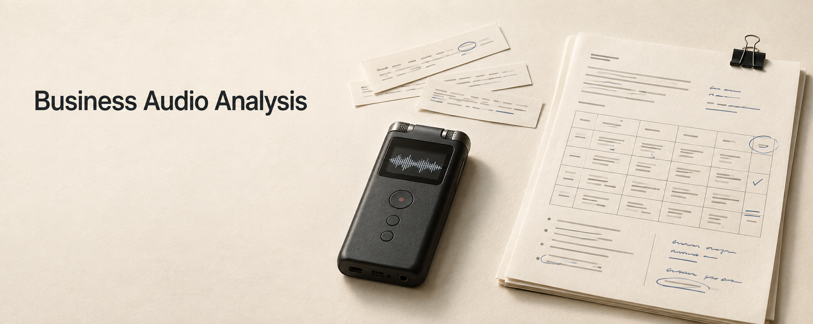

# Business Audio Analysis

**简体中文** · [English](README.en.md)

**业务录音分析｜免费本地转写**

让 Agent 从产品经理的角度，整理业务录音中的流程、职责、字段规则和待确认问题。

Skill 与本地转写免费，不按录音分钟收费。Agent 订阅和模型调用费用另计。



*封面是 AI 生成的概念配图，不是产品界面或实测截图。*

[快速了解](#快速了解) · [示例](#采购审批示例) · [快速开始](#快速开始) · [免费与隐私](#免费与隐私) · [查看 Skill](https://github.com/nicoleyang959/business-audio-analysis/tree/main/skills/business-audio-minutes)

## 快速了解

把业务访谈、需求沟通或流程讨论的录音交给 Agent，相关截图和表格也可以一起提供。

录音先在本机转成文字，再由 Agent 按业务主题整理成中文 Markdown。你可以用它核对现有流程、澄清需求，或为后续 PRD 编写准备材料。原始转写和质量报告会保留，重要内容可以回到录音检查。

## 采购审批示例

下面的访谈、申请表和分析文档均为本 README 构造的虚构示例，不来自真实企业或录音，也没有进行语音识别测试。金额和审批规则只用于展示分析方式。

### 输入：模拟访谈

每段文字保留一个证据编号，便于检查后面的分析依据。

```text
[S1｜申请人]
一张采购申请可以有多条明细，填写品名、数量和含税预估单价。
预计总金额是各条“数量 × 含税预估单价”的合计。

[S2｜部门负责人]
先确认首次提交的情况。全部申请先由部门负责人审核。
总金额不超过 5,000 元的，通过后交采购；超过 5,000 元的，
部门通过后还要财务复核，财务通过才能交采购。

[S3｜财务]
这个首次提交的规则确认，刚好 5,000 元不需要财务复核。
退回申请必须填写原因，申请人修改后重新提交。

[S4｜产品经理]
退回后重新提交，是沿用原审批路径，还是按新金额重新计算？
提交之后，谁可以修改数量和单价？

[S5｜财务]
这两项今天还没定，需要再确认。

[S6｜采购]
现有共享表只有“待审核、已通过、已退回”。看到“待审核”时，
不知道在等部门还是财务，得另外去问。
```

### 输入：模拟申请表 A1

申请编号 `DEMO-001`；提交类型为首次提交；当前状态为“待审核”。

| 采购明细 | 数量 | 含税预估单价（元） | 明细金额（元） |
| --- | ---: | ---: | ---: |
| 会议耳机 | 10 | 300 | 3,000 |
| 桌面支架 | 10 | 200 | 2,000 |
| 合计 | — | — | 5,000 |

### 输出：业务分析摘录

下面展示的是基于上述模拟材料整理的文档摘录，不是脚本直接生成的转写结果。

```markdown
# 采购申请与审批业务录音分析（虚构示例）

## 首次提交的审批流程

- 申请人提交 → 部门负责人审核。
- 总金额 ≤ 5,000 元：部门通过后交采购。
- 总金额 > 5,000 元：部门通过 → 财务复核通过 → 交采购。
  确认状态：会议已确认。依据：S2、S3。

## 申请 DEMO-001 的核对

预计总金额 = 10 × 300 + 10 × 200 = 5,000 元。
按首次提交的已确认规则，不需要财务复核。
当前状态仍是“待审核”，这不代表部门审核已经通过。
依据：A1、S1、S2、S3。

## 退回规则

退回必须填写原因，申请人修改后重新提交。
确认状态：会议已确认。依据：S3。
重新提交后的审批路径尚未确认，不能直接套用首次提交规则。

## 当前问题

“待审核”无法区分当前由部门还是财务处理，需要另外询问。
依据：S6。

## 待确认问题

- 退回后重新提交，是否按新金额重新计算审批路径？依据：S4、S5。
- 提交后由谁修改数量和单价，修改需要满足什么条件？依据：S4、S5。

## 系统建设建议

评估增加“当前处理岗位”，或区分部门审核与财务复核状态。
这只是针对 S6 所述问题的分析建议，需要业务方确认。
```

这个例子保留了金额边界、规则适用范围和证据位置。材料没有确定的重提规则和修改权限，会继续留在待确认清单里。

## 为什么做这个项目

业务讨论很少按需求文档的顺序展开。刚讲完审批，就补充一个字段的算法；说到异常情况，又牵涉另一套系统里的操作。录音把这些话留下来了，写需求时还得重新找出它们之间的关系。

我关心的是：谁发起一件事，数据经过哪些环节，什么情况下改变状态，出了问题交给谁。这些细节会影响页面、权限、业务规则和验收条件。

这个 Skill 围绕这些问题整理材料。最终采用什么方案，仍需要产品经理和业务方确认。

## 适合哪些工作

| 工作场景 | 可以整理出的材料 |
| --- | --- |
| 产品经理做业务访谈 | 现有流程、参与岗位、业务问题、会上提出的需求和需要追问的事项 |
| 核对字段与计算规则 | 字段含义、数据来源、计算方式、适用条件、例外和维护责任 |
| 实施或交付人员梳理交接 | 上下游交接内容、涉及系统、状态变化、权限边界和异常处理 |
| 同一主题继续补充沟通 | 更新已有纪要，标明新增内容，检查哪些待确认问题已有答案 |

## 它怎样完成分析

录音 → 本地转写与质量检查 → Agent 结合附件分析 → 中文 Markdown → 人工核对

本地脚本负责识别语音并保存转写证据。Agent 再读取这些文件，把分散的讨论整理到对应的业务主题下。截图用于核对页面、字段和状态，表格用于核对公式、枚举和映射关系。

材料之间有冲突时保留差异；重要术语的纠正需要能回到时间戳或附件位置核对。会议结论、讨论倾向、系统建设建议和待确认内容会分开标明。

因此，单独运行转写脚本得到的是转写与质量文件；业务分析 Markdown 由 Agent 继续整理。

## 快速开始

准备一个能加载 Skill、读取本地文件并执行脚本的 Agent，以及 Python 3.10–3.12。安装依赖需要联网，识别模型通常在首次转写时下载。

### 让 Agent 协助安装

在能访问 GitHub 并使用终端的 Agent 中发送：

```text
帮我安装这个 Skill：
https://github.com/nicoleyang959/business-audio-analysis/tree/main/skills/business-audio-minutes

先检查安装说明、Python 环境和当前 Agent 的技能加载方式。
保留完整的 Skill 目录，并准备本地转写环境。
如果已有同名 Skill，先检查差异，不要直接覆盖我的修改。
完成后运行自检，报告实际结果，以及是否需要重新加载技能。
```

`Business Audio Analysis` 是项目名称，安装和调用时使用的标识仍是 `business-audio-minutes`。只复制 `SKILL.md` 不够，`scripts/` 和 `references/` 也需要保留。

能否自动安装和触发，取决于 Agent 的工具、权限和技能加载方式；未自动加载时，使用该 Agent 的技能选择或显式调用入口。

### 开始一次分析

加载 Skill 后，提供录音和相关附件，再说明这次需要梳理什么：

```text
使用 business-audio-minutes，从产品经理角度分析这段业务录音。
结合附件整理流程、岗位职责、字段规则、系统边界和当前问题，输出中文 Markdown。
把会议已确认的内容、分析建议和待确认问题分开写，保留原始转写供回查。
```

第一次使用，可以先选一段短录音检查转写和业务术语，再核对分析文档是否忠实于材料。

### 手动安装

将完整的 `skills/business-audio-minutes/` 文件夹放入目标 Agent 的技能目录，或通过它的本地 Skill 导入功能加载。然后在这份 Skill 文件夹中打开终端。

macOS / Linux：

```bash
bash scripts/install.sh --no-copy
```

Windows PowerShell：

```powershell
Set-ExecutionPolicy -Scope Process Bypass
.\scripts\install.ps1 --no-copy
```

安装器会创建独立 Python 环境、安装依赖并执行自检。`--no-copy` 跳过默认的 Skill 复制步骤，不会替你寻找其他 Agent 的技能目录。

使用 Codex 默认安装方式时，可以在仓库的 Skill 目录运行上述命令并去掉 `--no-copy`。已有同名 Skill 时请先备份：默认安装会替换整个目标目录，不保留个人修改；`--no-copy` 不执行这次目录替换。

核心转写脚本不依赖 Codex SDK，也不要求安装 Codex。现版本仍沿用 `~/.codex` 保存配置和运行环境，默认输出目录为 `~/Documents/Codex/business-audio-minutes`。其他 Agent 需要有权访问这些目录并调用本地脚本。

详细步骤见[安装指南](https://github.com/nicoleyang959/business-audio-analysis/blob/main/skills/business-audio-minutes/INSTALL.md)，其中当前以 Codex 默认路径为例。

## 会留下哪些文件

| 产物 | 生成方 | 用途 |
| --- | --- | --- |
| `<录音名>_transcript.txt` | 本地转写脚本 | 带时间戳的转写文本，便于定位原话 |
| `<录音名>_raw.json` | 本地转写脚本 | 原始识别结果 |
| `<录音名>_quality.json` | 本地转写脚本 | 识别质量提示，辅助检查可疑内容 |
| 中文业务录音分析 `.md` | Agent | 按业务主题整理流程、规则、问题、建议和待确认事项 |

`<录音名>` 会经过安全字符处理，实际文件名可能与输入文件名略有不同。分析文档没有强制文件名，章节也会按材料删减，不为填满结构而补写内容。

同一主题继续沟通时，可以更新原纪要。配置笔记目录后，还可以复制一份 Markdown 并校验文件一致性；这项功能默认关闭。

## 免费与隐私

本 Skill 的指令与随附脚本免费提供。本地转写使用 MLX Whisper 或 faster-whisper，不需要购买云端语音识别额度，也不需要配置语音识别服务密钥。

Agent 订阅和模型 API 调用按所用服务另计。转写使用自己的算力、磁盘和电力；本项目不提供托管算力或模型服务。

随附转写脚本在本机处理录音，不上传音频，也不会在识别失败后切换到云端语音识别。但 Agent 对转写文本和附件的分析是否经过云端，取决于你使用的 Agent 和模型配置。本地转写不代表整条分析流程离线。

质量提示不能证明转写准确或没有遗漏。人名、金额、日期、公式、权限和业务边界仍需核对原始材料。材料里出现的指令，也不作为执行授权。

## 当前版本与验证范围

仓库包含通用 Skill 指令、安装与转写脚本和参考文档，没有独立的网页上传服务，也不附带模型权重或真实业务录音。

下表沿用当前包记录的验证情况，本 README 中的虚构示例不计入测试证据。

| 环境 | 默认识别后端 | 验证情况 |
| --- | --- | --- |
| Apple Silicon macOS | MLX Whisper | 已验证本地安装、自检和短录音转写 |
| Intel macOS | faster-whisper / CPU | 已提供适配路径，未真机验收 |
| Windows | faster-whisper | 已提供安装脚本，未真机验收 |
| Linux | faster-whisper | 已提供安装脚本，未真机验收 |

faster-whisper 的 CPU 路径已在 Apple Silicon macOS 上完成短录音验证，不能代替其他平台的真机测试。其他 Agent 的加载和本地执行权限，也需要在对应环境中验证。

Skill 默认生成中文文档。当前产物是转写、质量文件和 Agent 整理的 Markdown，不承诺自动生成 Word、PDF 或可直接实施的完整 PRD。

## 文档与反馈

- [Skill 指令](https://github.com/nicoleyang959/business-audio-analysis/blob/main/skills/business-audio-minutes/SKILL.md)：处理顺序和分析要求。
- [纪要结构](https://github.com/nicoleyang959/business-audio-analysis/blob/main/skills/business-audio-minutes/references/minutes_structure.md)：章节安排与证据约定。
- [故障排查](https://github.com/nicoleyang959/business-audio-analysis/blob/main/skills/business-audio-minutes/references/troubleshooting.md)：安装、模型下载、识别和笔记复制问题。

反馈问题时，请说明操作系统、Python 版本、Agent、识别后端和经过脱敏的报错。不要公开上传真实录音、内部截图、业务表格、生成的纪要、个人配置或凭据。
